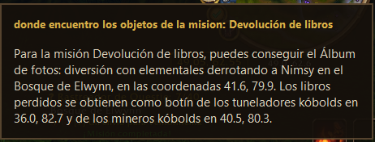

# AskForever

    

**[English](#english) · [Español](#español)**

[Security and transparency: what the companion does and never does](docs/SECURITY_TRANSPARENCY.md)

[Seguridad y transparencia: qué hace y qué no hace nunca el companion](docs/SEGURIDAD_TRANSPARENCIA.md)

---

## English

**AI assistant for WoW Forever.** Ask in plain language and get the answer over the game:

> *"How do I get from Westfall to The Barrens at a low level?"*

### What it does
AskForever knows your level, faction and zone, uses verified data from the game database (no guessing) and computes routes with flights and transports. The addon sends your question to the companion; the companion asks the AI and shows the answer over the game, on the right, for a few seconds.

### Status
**0.3.0-beta.4 (beta).** Quest questions say where to get each objective (drops, world objects, creatures) and understand your active quests. The addon and the Windows companion work together: ask with `/af` or the minimap button and read the answer in game. Verified data from the game database and routes with flights and transports are included. The companion is installed with a normal Windows setup program, and the first launch guides you through the free Google Gemini key. English and Spanish.

See the [ROADMAP](ROADMAP.md), the [CHANGELOG](CHANGELOG.md) and the [TODO](TODO.md).

### Design principles
- **No simulated input and no memory reading.** The addon only uses the official addon API.
- WoW addons cannot access the Internet, so a small desktop **companion** connects the addon to the AI.
- The companion uses Google Gemini with a free key; other providers are documented in the [API key guide](docs/API_KEYS.md).
- Languages: English and Spanish.

### Installation
1. **Addon:** install **AskForever** from the CurseForge app (select the **Forever** installation) or copy the `AskForever` folder from the addon zip into `World of Warcraft\_forever_\Interface\AddOns\`.
2. **Companion:** download the latest `AskForever-Setup-<version>.exe` from the [Releases page](https://github.com/warcrafted-server/AskForever/releases) and run it. It installs for your Windows user only, without administrator permission, and adds AskForever to the Start menu.
3. **Free key:** open AskForever. On first launch, a console window guides you through getting a free Google Gemini key (see the [Gemini key guide](docs/GEMINI_KEY.md)), checks it and saves it. The companion then downloads the game data (about 32 MB, once).

The addon folder also includes `README.txt` and a `docs` folder with the installation guide and the security and data transparency report.

👉 **[Full installation guide](docs/INSTALL_GUIDE.md)**

### Disclaimer
AI answers may contain mistakes; double-check important details in game. Blizzard has no official position on desktop companions: AskForever is designed not to automate any gameplay action, but use it at your own risk.

---

## Español

**Asistente de IA para WoW Forever.** Pregunta en lenguaje natural y recibe la respuesta sobre el juego:

> *"¿Por dónde voy de Páramos de Poniente a Baldíos siendo nivel bajo?"*

### Qué hace
AskForever conoce tu nivel, facción y zona, usa datos verificados de la base de datos del juego (no inventa) y calcula rutas con vuelos y transportes. El addon envía tu pregunta al companion; el companion consulta a la IA y muestra la respuesta sobre el juego, a la derecha, durante unos segundos.

### Estado
**0.3.0-beta.4 (beta).** Las preguntas de misión dicen dónde conseguir cada objetivo (botín, objetos del mundo, criaturas) y entienden tus misiones activas. El addon y el companion de Windows funcionan juntos: pregunta con `/af` o el botón del minimapa y lee la respuesta dentro del juego. Incluye datos verificados de la base de datos del juego y rutas con vuelos y transportes. El companion se instala con un programa de instalación normal de Windows y, la primera vez, te guía para conseguir la clave gratuita de Google Gemini. Inglés y español.

Consulta la [hoja de ruta](ROADMAP.md), el [CHANGELOG](CHANGELOG.md) y el [TODO](TODO.md).

### Principios de diseño
- **No simula teclas ni lee la memoria del juego.** El addon solo usa la API oficial de addons.
- Los addons de WoW no pueden acceder a Internet, así que un pequeño **companion** de escritorio conecta el addon con la IA.
- El companion usa Google Gemini con una clave gratuita; otros proveedores están documentados en la [guía de claves de API](docs/CLAVES_API.md).
- Idiomas: inglés y español.

### Instalación
1. **Addon:** instala **AskForever** desde la app de CurseForge (selecciona la instalación **Forever**) o copia la carpeta `AskForever` del zip del addon en `World of Warcraft\_forever_\Interface\AddOns\`.
2. **Companion:** descarga el último `AskForever-Setup-<versión>.exe` de la [página de Releases](https://github.com/warcrafted-server/AskForever/releases) y ejecútalo. Se instala solo para tu usuario de Windows, sin permisos de administrador, y añade AskForever al menú Inicio.
3. **Clave gratuita:** abre AskForever. La primera vez, una ventana de consola te guía para conseguir una clave gratuita de Google Gemini (consulta la [guía de la clave de Gemini](docs/CLAVE_GEMINI.md)), la comprueba y la guarda. Después, el companion descarga los datos del juego (unos 32 MB, una sola vez).

La carpeta del addon también incluye `README.txt` y una carpeta `docs` con la guía de instalación y el informe de seguridad y transparencia de datos.

👉 **[Guía de instalación completa](docs/GUIA_INSTALACION.md)**

### Aviso
Las respuestas de IA pueden contener errores; verifica lo importante en el juego. Blizzard no tiene una postura oficial sobre programas de escritorio: AskForever está diseñado para no automatizar ninguna acción de juego, pero úsalo bajo tu responsabilidad.

---

**Author / Autor:** WarCrafted · warcrafted.server@gmail.com
**License / Licencia:** [CC BY-NC 4.0](LICENSE) · World of Warcraft is a trademark of Blizzard Entertainment, Inc. Not affiliated with Blizzard.
