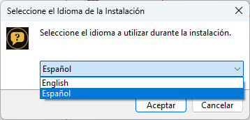
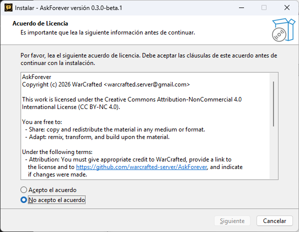
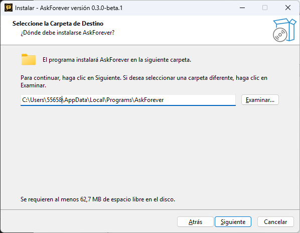
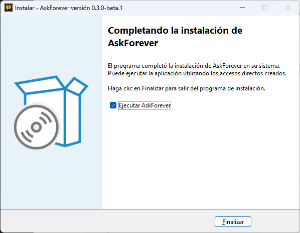
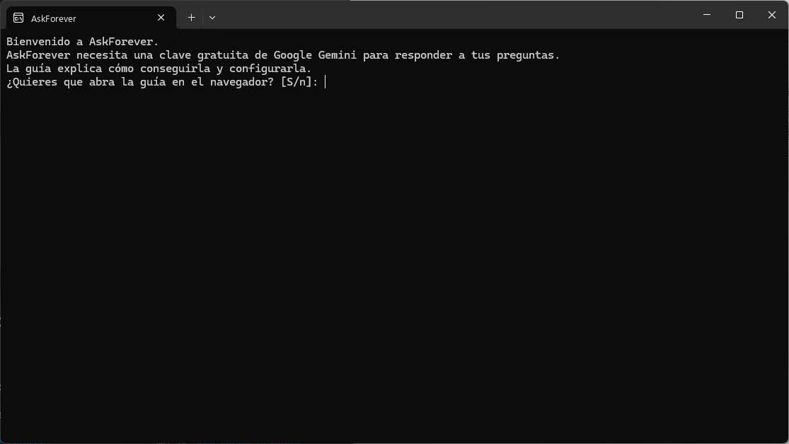
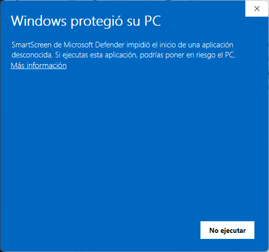

# Guía de instalación de AskForever (ES)

**[English version](INSTALL_GUIDE.md)**

Esta guía es para **AskForever 0.3.0-beta.3**. La primera vez se tarda unos **10 minutos**.

AskForever tiene dos partes:

- El **addon**: la ventana de AskForever dentro de World of Warcraft.
- El **companion**: un pequeño programa de Windows que habla con la IA y muestra la respuesta sobre el juego.

## Antes de empezar

Necesitas:

- Windows 10 u 11 de 64 bits.
- World of Warcraft: **WoW Forever** instalado.
- Una **cuenta de Google**, gratuita, para crear la clave de Gemini.

## 1. Instalar el addon

### App de CurseForge (recomendada)

1. Abre la app de **CurseForge** y elige **World of Warcraft**.
2. Comprueba que está seleccionada la instalación **Forever**. Si no aparece, usa **Scan for games** (buscar juegos) o añade la carpeta `World of Warcraft\_forever_`.
3. Busca **AskForever**, ábrelo y pulsa **Instalar**.

### Instalación manual

1. Descarga el **.zip** del addon AskForever de la [página de Releases](https://github.com/warcrafted-server/AskForever/releases) (o usa el archivo de CurseForge).
2. Descomprímelo y copia la carpeta `AskForever` en `World of Warcraft\_forever_\Interface\AddOns\`.
3. Comprueba que la carpeta contiene `AskForever.toc`: `...\AddOns\AskForever\AskForever.toc`.
4. Si el juego está abierto, ciérralo del todo y vuelve a abrirlo. `/reload` no carga addons nuevos. En la selección de personaje, pulsa **AddOns** y marca **AskForever**.

La carpeta del addon también incluye `README.txt` y una carpeta `docs` con esta guía y el informe de seguridad y transparencia de datos.

La primera vez que entres al juego con el addon, AskForever muestra una ventana de bienvenida con estos pasos y los enlaces al companion y a la guía de la clave gratuita. Puedes abrirla de nuevo cuando quieras con `/af help` o el botón **?** de la ventana del addon.

## 2. Instalar el companion

1. En la [página de Releases](https://github.com/warcrafted-server/AskForever/releases), descarga **`AskForever-Setup-0.3.0-beta.3.exe`**. El nombre incluye la versión.
2. Haz doble clic en el archivo para ejecutarlo.

3. Si Windows muestra un aviso, lee [Si Windows muestra un aviso](#si-windows-muestra-un-aviso).
4. El instalador funciona **solo para tu usuario de Windows**. No pide permisos de administrador. Instala AskForever en `%LOCALAPPDATA%\Programs\AskForever` y añade un acceso directo al menú Inicio.
5. Pulsa **Finalizar**. Si el instalador ofrece abrir AskForever, puedes dejar que se abra. Si no, abre **AskForever** desde el menú Inicio.

## 3. Primer arranque: clave gratuita de Gemini y datos del juego

1. Abre **AskForever** desde el menú Inicio. Se abre una ventana de consola, una ventana negra con texto.
2. La primera vez, un asistente explica que AskForever necesita una clave gratuita de Google Gemini. Si no tienes una, sigue la [guía de la clave de Gemini](CLAVE_GEMINI.md). Es gratuita y se tarda unos minutos.

3. Pega la clave cuando el asistente la pida. El asistente la prueba y la guarda en el **Administrador de credenciales de Windows**, el lugar seguro donde Windows guarda las contraseñas.
4. Cuando la clave funciona, AskForever descarga los datos del juego: unos **32 MB**, una sola vez. Después se actualizan solos. Mantén la ventana abierta hasta que termine.
5. Si ya guardaste una clave, el asistente no aparece; AskForever se inicia directamente.

## 4. Jugar

1. Mantén la ventana de consola de AskForever **abierta** mientras juegas. Si la cierras, AskForever se detiene.
2. Abre WoW Forever e inicia sesión.
3. En el juego, escribe `/af` (o `/askforever`) en el chat del juego y pulsa Enter, o haz clic en el botón **AskForever** del minimapa. Se abre la ventana de AskForever.
4. Escribe tu pregunta en esa ventana y pulsa Enter. Por ejemplo: *¿Por dónde voy a Baldíos?*
5. La respuesta aparece sobre el juego, a la derecha, durante unos segundos.
6. Para que funcione mejor, usa el modo de pantalla **Ventana** o **Pantalla completa (ventana)**. La pantalla completa exclusiva (la que ocupa toda la pantalla) puede impedir que aparezca la respuesta.

## Si Windows muestra un aviso

Windows SmartScreen es el sistema de avisos integrado de Windows. Puede mostrar **«Windows protegió su PC»** porque AskForever no se distribuye por la Microsoft Store ni está firmado con un certificado de pago. Eso no significa que el archivo sea peligroso.

1. Ejecuta solo el instalador que descargaste de la [página oficial de Releases](https://github.com/warcrafted-server/AskForever/releases).
2. Pulsa **Más información** y después **Ejecutar de todas formas**.

   

   
3. La [página de seguridad y transparencia](SEGURIDAD_TRANSPARENCIA.md) explica qué hace el companion y cómo comprobar el archivo descargado.

## Uso diario

- Deja abierta la ventana de consola de AskForever mientras juegas; si la cierras, AskForever se detiene.
- Usa `/af` o el botón del minimapa para preguntar.
- La respuesta aparece a la derecha durante unos segundos. Usa el modo Ventana o Pantalla completa (ventana).

## Cambiar la clave

1. Pulsa la **tecla Windows + R** (se abre el cuadro Ejecutar), pega `%LOCALAPPDATA%\Programs\AskForever` y pulsa Enter. Se abre la carpeta donde está instalado AskForever para tu usuario.
2. En la ventana de la carpeta, haz clic en la barra de direcciones de arriba (la que muestra la ruta), escribe `powershell` y pulsa Enter. Se abre una ventana de terminal en esa carpeta.
3. Escribe `.\AskForever.exe setup` y pulsa Enter. El asistente se abre otra vez para que escribas una clave nueva.

## Actualizar

1. Descarga el nuevo `AskForever-Setup-<versión>.exe` de la [página de Releases](https://github.com/warcrafted-server/AskForever/releases) y ejecútalo encima de la instalación anterior. La clave guardada se conserva.
2. Si hay una versión nueva del addon, actualízalo igual que lo instalaste: con la app de CurseForge o copiando la carpeta `AskForever` nueva.

## Desinstalar

1. Abre **Configuración > Aplicaciones > AskForever > Desinstalar**. Se borran el programa, la clave guardada y los datos del juego descargados.
2. Quita el addon desde la app de CurseForge o borra `World of Warcraft\_forever_\Interface\AddOns\AskForever`.

## Problemas frecuentes

| Problema | Qué hacer |
|---|---|
| No aparece la respuesta | Comprueba que la ventana de consola de AskForever sigue abierta y que el juego está en modo Ventana o Pantalla completa (ventana). |
| La respuesta dice que falta la clave o que has llegado al límite del plan gratuito | Espera un minuto y vuelve a preguntar. Si sigue diciendo que falta la clave, ejecuta setup (consulta [Cambiar la clave](#cambiar-la-clave)). |
| El addon no aparece en el juego | Cierra el juego por completo, vuelve a abrirlo y activa **AskForever** en la lista de AddOns de la selección de personaje. |
