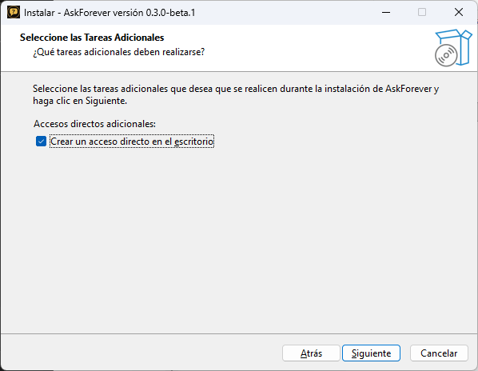
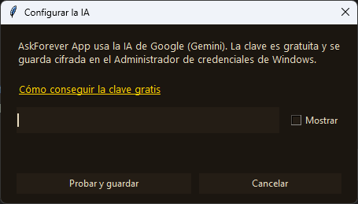
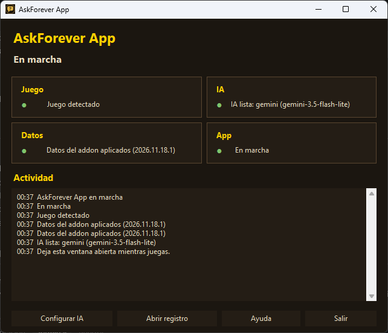
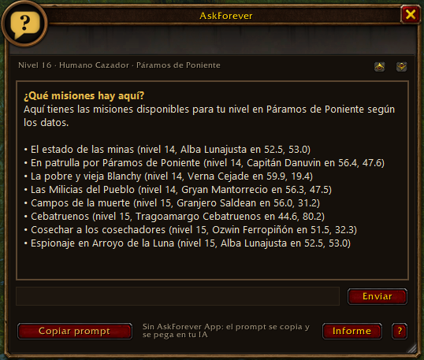
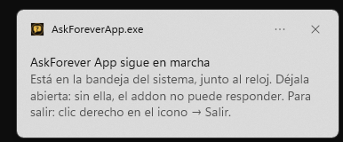
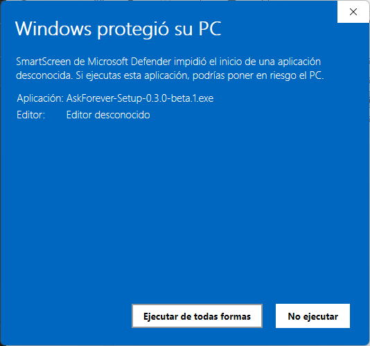

# Guía de instalación de AskForever (ES)

**[English version](INSTALL_GUIDE.md)**

Esta guía explica cómo instalar y usar AskForever. La primera configuración tarda unos **10 minutos**.

AskForever tiene dos partes:

- El **addon**: la ventana de AskForever dentro de World of Warcraft.
- **AskForever App**: una app de Windows que conecta el addon con la IA y muestra las respuestas sobre el juego.

## Antes de empezar

Necesitas:

- Windows 10 u 11 de 64 bits.
- World of Warcraft: **WoW Forever** instalado.
- Una **cuenta de Google**, gratuita, para crear la clave de Gemini.

## 1. Instalar el addon

### App de CurseForge (recomendada)

1. Abre la app de **CurseForge** y elige **World of Warcraft**.
2. Comprueba que está seleccionada la instalación **Forever**. Si no aparece, usa **Scan for games** (buscar juegos) o añade la carpeta `World of Warcraft\_forever_`.
3. Busca **AskForever**, ábrelo y pulsa **Instalar**.

### Instalación manual

1. Descarga el **.zip** del addon AskForever de la [última versión](https://github.com/warcrafted-server/AskForever/releases/latest) (o usa el archivo de CurseForge).
2. Descomprímelo y copia la carpeta `AskForever` en `World of Warcraft\_forever_\Interface\AddOns\`.
3. Comprueba que la carpeta contiene `AskForever.toc`: `...\AddOns\AskForever\AskForever.toc`.
4. Si el juego está abierto, ciérralo del todo y vuelve a abrirlo. `/reload` no carga addons nuevos. En la selección de personaje, pulsa **AddOns** y marca **AskForever**.

La carpeta del addon también incluye `README.txt` y una carpeta `docs` con esta guía y el informe de seguridad y transparencia de datos.

La primera vez que entres al juego con el addon, AskForever muestra una ventana de bienvenida con estos pasos y enlaces a AskForever App y a la guía de la clave gratuita. Puedes abrirla de nuevo cuando quieras con `/af help` o el botón **?** de la ventana del addon.

## 2. Instalar AskForever App

1. En la [página de la última versión](https://github.com/warcrafted-server/AskForever/releases/latest), descarga **`AskForever-Setup-<versión>.exe`**.
2. Haz doble clic en el archivo para ejecutarlo.

3. Si Windows muestra un aviso, lee [Si Windows muestra un aviso](#si-windows-muestra-un-aviso).
4. El instalador funciona **solo para tu usuario de Windows**. No pide permisos de administrador. Instala AskForever App en `%LOCALAPPDATA%\Programs\AskForever` y añade un acceso directo de **AskForever App** al menú Inicio.
5. Pulsa **Finalizar**. Si el instalador ofrece abrir AskForever App, puedes dejar que se abra. Si no, abre **AskForever App** desde el menú Inicio.

Si tienes instalada la versión antigua del programa de Windows, instala AskForever App una vez encima. Se conservan la clave de IA y los datos del juego.

## 3. Primer arranque: configurar la IA y los datos del juego

1. Abre **AskForever App** desde el menú Inicio. La ventana usa el idioma configurado en Windows.
2. La primera vez se abre el diálogo **Configurar IA** para Google Gemini. Sigue la [guía de la clave de Gemini](CLAVE_GEMINI.md) para conseguir una clave gratuita, introdúcela en el diálogo y pulsa **Probar y guardar**. La app prueba la clave antes de guardarla cifrada en el **Administrador de credenciales de Windows**.

   
3. Si ya tienes una clave guardada, el diálogo no aparece. Para configurar o cambiar una clave más adelante, pulsa **Configurar IA** en la ventana de la app.
4. Cuando el addon instalado necesita la base de datos, la app la descarga desde GitHub, comprueba su integridad y aplica el parche de datos del juego y las fichas incluidos en la carpeta `data` del addon. Esto ocurre una vez por cada base necesaria; la reconstrucción tarda unos segundos. Mantén AskForever App en marcha mientras termina.

La ventana de la app muestra cuatro tarjetas de estado:

- **Juego:** indica si se ha detectado WoW.
- **IA:** el proveedor y el modelo configurados, y si la clave está lista.
- **Datos:** la versión de la base de datos y la del parche de datos del addon.
- **App:** la versión de la app y cuándo comprobó actualizaciones por última vez.

La lista de actividad muestra eventos recientes en lenguaje sencillo. **Abrir registro** abre el registro técnico en `%LOCALAPPDATA%\AskForever\logs\app.log`; **Ayuda** abre esta guía.

## 4. Jugar

1. Mantén **AskForever App en marcha** mientras juegas; el addon la necesita para responder preguntas.
2. Abre WoW Forever e inicia sesión.
3. En el juego, escribe `/af` (o `/askforever`) en el chat del juego y pulsa Enter, o haz clic en el botón **AskForever** del minimapa. Se abre la ventana del chat de AskForever.
4. Escribe tu pregunta en esa ventana y pulsa Enter. Por ejemplo: *¿Por dónde voy a Baldíos?*
5. La respuesta aparece en la conversación de la ventana del addon, con párrafos y viñetas.

    Desplázate por la conversación con la rueda del ratón encima o con sus botones de flecha. Cambia el tamaño de la ventana del addon desde la esquina inferior derecha.
6. Para que funcione mejor, usa el modo de pantalla **Ventana** o **Pantalla completa (ventana)**. La pantalla completa exclusiva (la que ocupa toda la pantalla) puede impedir que aparezca la respuesta.

### Ventana y bandeja del sistema de AskForever App

Al cerrar la ventana de la app, se oculta en la bandeja del sistema; AskForever App **no se cierra**. Aparece un aviso que explica que el addon necesita la app en marcha. Haz clic en el icono de la bandeja para volver a abrir la ventana. Para salir, haz clic derecho en el icono y elige **Salir**; la app te pedirá confirmación.

## Si Windows muestra un aviso

Windows SmartScreen es el sistema de avisos integrado de Windows. Puede mostrar **«Windows protegió tu PC»** porque AskForever no se distribuye por la Microsoft Store ni está firmado con un certificado de pago. Eso no significa que el archivo sea peligroso.

1. Ejecuta solo el instalador que descargaste de la [página oficial de la última versión](https://github.com/warcrafted-server/AskForever/releases/latest).
2. Pulsa **Más información** y después **Ejecutar de todas formas**.

   

   
3. La [página de seguridad y transparencia](SEGURIDAD_TRANSPARENCIA.md) explica qué hace AskForever App y cómo se comprueban las descargas.

## Uso diario

- Mantén AskForever App en marcha mientras juegas. Al cerrar su ventana, queda en la bandeja del sistema; el addon necesita la app en marcha para responder.
- Usa `/af` o el botón del minimapa para preguntar.
- La respuesta aparece a la derecha durante unos segundos. Usa el modo Ventana o Pantalla completa (ventana).
- Desplázate por la conversación con la rueda del ratón encima o con los botones de flecha; cambia el tamaño de la ventana del addon desde la esquina inferior derecha.
- Para salir de AskForever App, haz clic derecho en su icono de la bandeja del sistema, elige **Salir** y confirma.

## Configurar la clave de IA

Pulsa **Configurar IA** en la ventana de AskForever App para introducir o cambiar tu clave de Gemini. La app la prueba antes de guardarla de forma segura. Para saber cómo crear una clave, consulta la [guía de la clave de Gemini](CLAVE_GEMINI.md).

## Actualizaciones

- **AskForever App:** busca actualizaciones al iniciarse y cada seis horas. Cuando hay una actualización, la app lo indica en su ventana y en la bandeja del sistema, espera a que termine cualquier respuesta en curso, comprueba la descarga, instala en silencio y vuelve a abrirse. No tienes que hacer nada.
- **Datos del juego y fichas:** actualiza el addon **AskForever** en CurseForge (o instala manualmente el nuevo zip del addon). AskForever App lee los datos incluidos y descarga desde GitHub una base de datos comprobada cuando hace falta; no tienes que reinstalar la app para recibir datos nuevos.
- **Versión antigua de la app:** instala AskForever App una vez encima de la instalación existente. Se conservan la clave y los datos del juego.

## Desinstalar

1. Abre **Configuración > Aplicaciones > AskForever App > Desinstalar**. Se eliminan la app y sus archivos, incluida la clave guardada y los datos locales.
2. Quita el addon desde la app de CurseForge o borra `World of Warcraft\_forever_\Interface\AddOns\AskForever`.

## Problemas frecuentes

| Problema | Qué hacer |
|---|---|
| No aparece la respuesta | Comprueba que AskForever App está en marcha (busca su icono en la bandeja) y que el juego está en modo Ventana o Pantalla completa (ventana). |
| La respuesta dice que falta la clave o que has llegado al límite del plan gratuito | Abre **Configurar IA** para comprobar la clave o, si has llegado al límite, espera un minuto y vuelve a preguntar. |
| El addon no aparece en el juego | Cierra el juego por completo, vuelve a abrirlo y activa **AskForever** en la lista de AddOns de la selección de personaje. |
