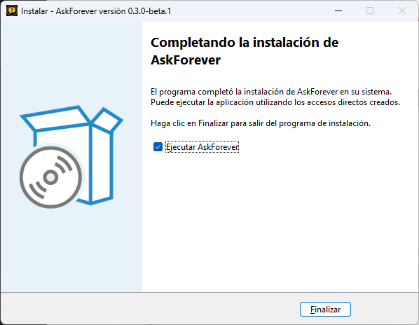

# AskForever installation guide (EN)

**[Versión en español](GUIA_INSTALACION.md)**

This guide is for **AskForever 0.3.0-beta.4**. The first time takes about **10 minutes**.

AskForever has two parts:

- The **addon**: the AskForever window inside World of Warcraft.
- The **companion**: a small Windows program that talks to the AI and shows the answer over the game.

## Before you start

You need:

- Windows 10 or 11 (64-bit).
- World of Warcraft: **WoW Forever** installed.
- A **Google account**, free, to create the Gemini key.

## 1. Install the addon

### CurseForge app (recommended)

1. Open the **CurseForge** app and choose **World of Warcraft**.
2. Make sure the **Forever** installation is selected. If it is not listed, use **Scan for games** or add the `World of Warcraft\_forever_` folder.
3. Search for **AskForever**, open it and click **Install**.

### Manual install

1. Download the AskForever addon **.zip** from the [Releases page](https://github.com/warcrafted-server/AskForever/releases) (or use the file from CurseForge).
2. Unzip it and copy the `AskForever` folder to `World of Warcraft\_forever_\Interface\AddOns\`.
3. Check that the folder contains `AskForever.toc`: `...\AddOns\AskForever\AskForever.toc`.
4. If the game is open, close it completely and start it again. `/reload` does not load new addons. At character select, click **AddOns** and tick **AskForever**.

The addon folder also includes `README.txt` and a `docs` folder with this guide and the security and data transparency report.

The first time you enter the game with the addon, AskForever shows a welcome window with these steps and the links to the companion and the free key guide. You can open it again at any time with `/af help` or the **?** button in the addon window.

## 2. Install the companion

1. On the [Releases page](https://github.com/warcrafted-server/AskForever/releases), download **`AskForever-Setup-0.3.0-beta.4.exe`**. The file name includes the version.
2. Double-click the file to run it.

3. If Windows shows a warning, read [If Windows shows a warning](#if-windows-shows-a-warning) below.
4. The installer works **only for your Windows user**. It does not ask for administrator permission. It installs AskForever in `%LOCALAPPDATA%\Programs\AskForever` and adds a shortcut to the Start menu.
5. Click **Finish**. If the installer offers to open AskForever, you can let it open. Otherwise, open **AskForever** from the Start menu.

## 3. First launch: free Gemini key and game data

1. Open **AskForever** from the Start menu. A console window, a black window with text, opens.
2. The first time, an assistant explains that AskForever needs a free Google Gemini key. If you do not have one, follow the [Gemini key guide](GEMINI_KEY.md). It is free and takes a few minutes.

3. Paste the key when the assistant asks. The assistant tests it and saves it in the **Windows Credential Manager**, the secure place where Windows stores passwords.
4. When the key works, AskForever downloads the game data: about **32 MB**, only once. It updates automatically later. Keep the window open until it finishes.
5. If you already saved a key, the assistant does not appear; AskForever starts directly.

## 4. Play

1. Keep the AskForever console window **open** while you play. Closing this window stops AskForever.
2. Start WoW Forever and log in.
3. In the game, type `/af` (or `/askforever`) in the game chat and press Enter, or click the **AskForever** button on the minimap. The AskForever window opens.
4. Type your question in that window and press Enter. For example: *How do I get to The Barrens?*
5. The answer appears over the game, on the right, for a few seconds.
6. For the best result, use the **Windowed** or **Windowed (Fullscreen)** display mode. Exclusive fullscreen (the mode that takes over the whole screen) may prevent the answer from appearing.

## If Windows shows a warning

Windows SmartScreen is Windows' built-in warning system. It may show **"Windows protected your PC"** because AskForever is not distributed through the Microsoft Store and is not signed with a paid certificate. That does not mean the file is dangerous.

1. Only run the installer you downloaded from the official [Releases page](https://github.com/warcrafted-server/AskForever/releases).
2. Click **More info** and then **Run anyway**.

   

   
3. The [security and transparency page](SECURITY_TRANSPARENCY.md) explains what the companion does and how to check the downloaded file.

## Daily use

- Leave the AskForever console window open while you play; closing it stops AskForever.
- Use `/af` or the minimap button to ask.
- The answer appears on the right for a few seconds. Use Windowed or Windowed (Fullscreen) mode.

## Change the key

1. Press the **Windows key + R** (this opens the Run box), paste `%LOCALAPPDATA%\Programs\AskForever` and press Enter. This opens the folder where AskForever is installed for your user.
2. In the folder window, click the address bar at the top (the bar that shows the folder path), type `powershell` and press Enter. A terminal window opens in that folder.
3. Type `.\AskForever.exe setup` and press Enter. The assistant opens again so you can enter a new key.

## Update

1. Download the new `AskForever-Setup-<version>.exe` from the [Releases page](https://github.com/warcrafted-server/AskForever/releases) and run it over the old installation. Your saved key is kept.
2. If there is a new addon version, update it the same way you installed it: with the CurseForge app or by copying the new `AskForever` folder.

## Uninstall

1. Open **Settings > Apps > AskForever > Uninstall**. This removes the program, the saved key and the downloaded game data.
2. Remove the addon from the CurseForge app, or delete `World of Warcraft\_forever_\Interface\AddOns\AskForever`.

## Common problems

| Problem | What to do |
|---|---|
| No answer appears | Check that the AskForever console window is still open and that the game is in Windowed or Windowed (Fullscreen) mode. |
| The answer says the key is missing or you reached the free-plan limit | Wait a minute and ask again. If it still says the key is missing, run setup (see [Change the key](#change-the-key)). |
| The addon does not appear in game | Close the game completely, start it again, and enable **AskForever** in the AddOns list at character select. |
