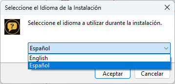
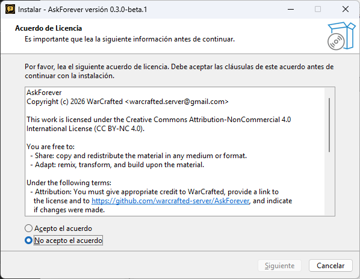
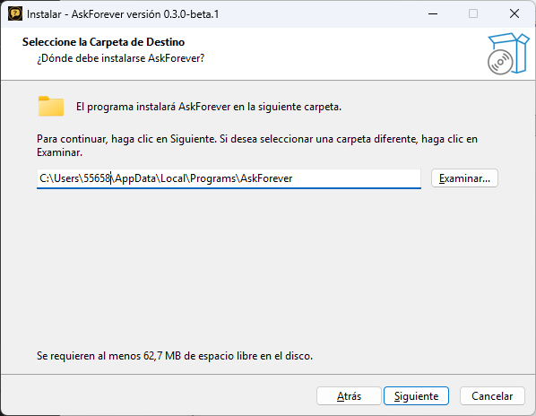
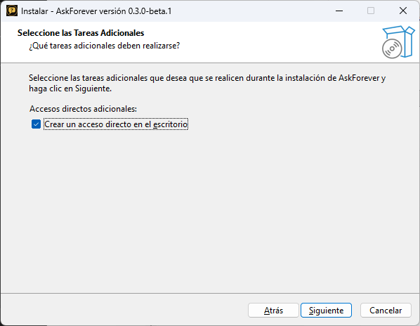
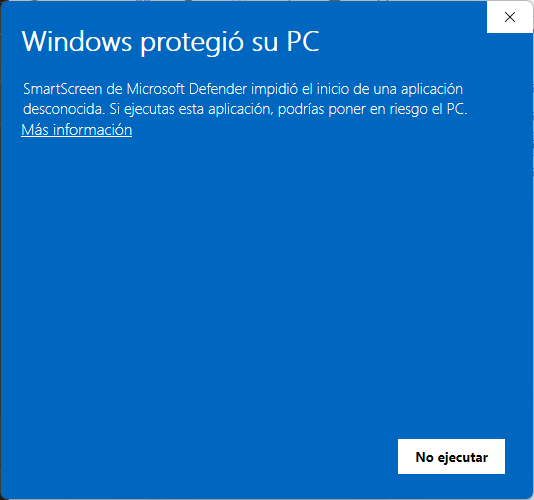
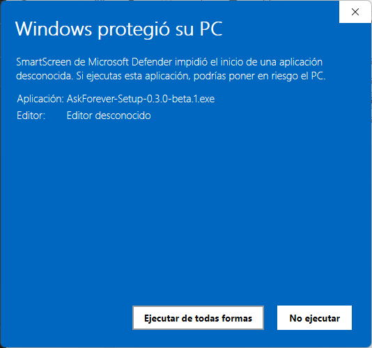

# AskForever installation guide (EN)

**[Versión en español](GUIA_INSTALACION.md)**

This guide covers installing and using AskForever. The first setup takes about **10 minutes**.

AskForever has two parts:

- The **addon**: the AskForever window inside World of Warcraft.
- **AskForever App**: a Windows app that connects the addon to the AI and shows answers over the game.

## Before you start

You need:

- Windows 10 or 11 (64-bit).
- World of Warcraft: **WoW Forever** installed.
- A **Google account**, free, to create the Gemini key.

## 1. Install the addon

### CurseForge app (recommended)

1. Open the **CurseForge** app and choose **World of Warcraft**.
2. Make sure the **Forever** installation is selected. If it is not listed, use **Scan for games** or add the `World of Warcraft\_forever_` folder.
3. Search for **AskForever**, open it and click **Install**.

### Manual install

1. Download the AskForever addon **.zip** from the [latest release](https://github.com/warcrafted-server/AskForever/releases/latest) (or use the file from CurseForge).
2. Unzip it and copy the `AskForever` folder to `World of Warcraft\_forever_\Interface\AddOns\`.
3. Check that the folder contains `AskForever.toc`: `...\AddOns\AskForever\AskForever.toc`.
4. If the game is open, close it completely and start it again. `/reload` does not load new addons. At character select, click **AddOns** and tick **AskForever**.

The addon folder also includes `README.txt` and a `docs` folder with this guide and the security and data transparency report.

The first time you enter the game with the addon, AskForever shows a welcome window with these steps and links to AskForever App and the free key guide. You can open it again at any time with `/af help` or the **?** button in the addon window.

## 2. Install AskForever App

1. On the [latest release page](https://github.com/warcrafted-server/AskForever/releases/latest), download **`AskForever-Setup-<version>.exe`**.
2. Double-click the file to run it.

3. If Windows shows a warning, read [If Windows shows a warning](#if-windows-shows-a-warning) below.
4. The installer works **only for your Windows user**. It does not ask for administrator permission. It installs AskForever App in `%LOCALAPPDATA%\Programs\AskForever` and adds an **AskForever App** shortcut to the Start menu.
5. Click **Finish**. If the installer offers to open AskForever App, you can let it open. Otherwise, open **AskForever App** from the Start menu.

If you have the older version of the Windows app installed, install AskForever App once over it. Your saved AI key and game data are kept.

## 3. First launch: configure AI and game data

1. Open **AskForever App** from the Start menu. Its window uses the language set in Windows.
2. On first launch, the **Configure AI** dialog opens for Google Gemini. Follow the [Gemini key guide](GEMINI_KEY.md) to get a free key, enter it in the dialog and click **Test and save**. The app tests the key before saving it encrypted in **Windows Credential Manager**.
3. If you already have a saved key, the setup dialog does not appear. To change or configure a key later, click **Configure AI** in the app window.
4. The app downloads the base game database from GitHub when the installed addon needs it, verifies it, then applies the game-data patch and guide cards shipped in the addon's `data` folder. This happens once for each needed base database; rebuilding takes seconds. Keep AskForever App running while it finishes.

The app window shows four status cards:

- **Game:** whether WoW is detected.
- **AI:** the configured provider and model, and whether its key is ready.
- **Data:** the base database version and the addon's data-patch version.
- **App:** the app version and when it last checked for an update.

The activity list reports recent events in plain language. **Open log** opens the technical log at `%LOCALAPPDATA%\AskForever\logs\app.log`; **Help** opens this guide.

## 4. Play

1. Keep **AskForever App running** while you play; the addon needs it to answer questions.
2. Start WoW Forever and log in.
3. In the game, type `/af` (or `/askforever`) in the game chat and press Enter, or click the **AskForever** button on the minimap. The AskForever chat window opens.
4. Type your question in that window and press Enter. For example: *How do I get to The Barrens?*
5. The answer appears over the game, on the right, for a few seconds. Scroll the conversation with the mouse wheel over it or use its arrow buttons. Resize the addon window from its bottom-right corner.
6. For the best result, use the **Windowed** or **Windowed (Fullscreen)** display mode. Exclusive fullscreen (the mode that takes over the whole screen) may prevent the answer from appearing.

### AskForever App window and system tray

Closing the app window hides it in the system tray; it does **not** quit AskForever App. A notice explains that the addon needs the app running. Click the tray icon to reopen the window. To quit, right-click the icon and choose **Quit**; the app asks you to confirm.

## If Windows shows a warning

Windows SmartScreen is Windows' built-in warning system. It may show **"Windows protected your PC"** because AskForever is not distributed through the Microsoft Store and is not signed with a paid certificate. That does not mean the file is dangerous.

1. Only run the installer you downloaded from the official [latest release page](https://github.com/warcrafted-server/AskForever/releases/latest).
2. Click **More info** and then **Run anyway**.

   

   
3. The [security and transparency page](SECURITY_TRANSPARENCY.md) explains what AskForever App does and how downloads are checked.

## Daily use

- Keep AskForever App running while you play. Closing its window sends it to the system tray; the addon needs the app running to answer.
- Use `/af` or the minimap button to ask.
- The answer appears on the right for a few seconds. Use Windowed or Windowed (Fullscreen) mode.
- Scroll the conversation with the mouse wheel over it or its arrow buttons; resize the addon window from its bottom-right corner.
- To exit AskForever App, right-click its system-tray icon and choose **Quit**, then confirm.

## Configure the AI key

Click **Configure AI** in the AskForever App window to enter or replace your Gemini key. The app tests it before saving it securely. For steps to create a key, see the [Gemini key guide](GEMINI_KEY.md).

## Updates

- **AskForever App:** it checks for updates when it starts and every six hours. When an update is available, the app reports it in its window and system tray, waits for any answer in progress to finish, verifies the download, installs silently, and reopens itself. No action is needed.
- **Game data and guide cards:** update the **AskForever** addon in CurseForge (or install the new addon zip manually). AskForever App reads the included data and downloads a verified base database from GitHub when needed; you do not need to reinstall the app to get new game data.
- **Older app:** install AskForever App once over the existing installation. Your key and game data are kept.

## Uninstall

1. Open **Settings > Apps > AskForever App > Uninstall**. This removes the app and its files, including its saved key and local data.
2. Remove the addon from the CurseForge app, or delete `World of Warcraft\_forever_\Interface\AddOns\AskForever`.

## Common problems

| Problem | What to do |
|---|---|
| No answer appears | Check that AskForever App is running (look for its tray icon) and that the game is in Windowed or Windowed (Fullscreen) mode. |
| The answer says the key is missing or you reached the free-plan limit | Open **Configure AI** to check the key, or wait a minute and ask again if you reached the limit. |
| The addon does not appear in game | Close the game completely, start it again, and enable **AskForever** in the AddOns list at character select. |
